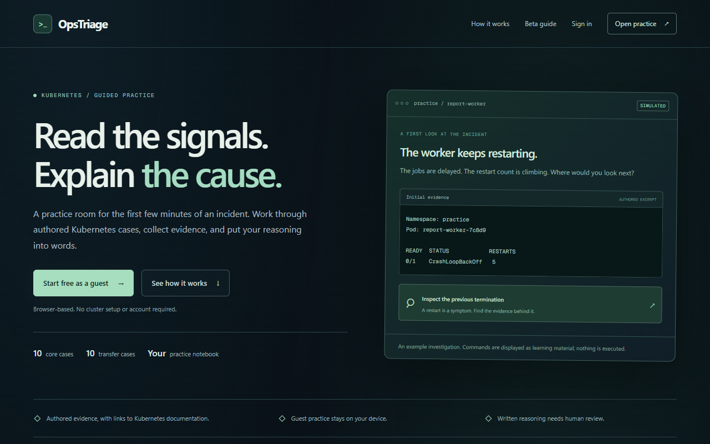
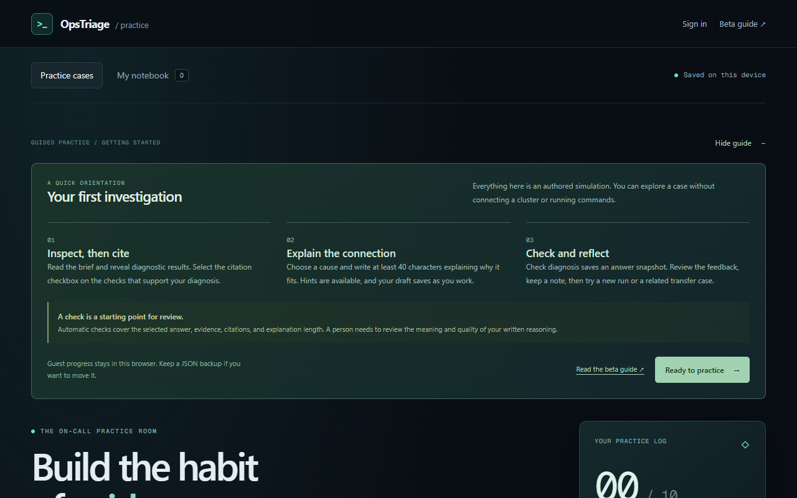

# OpsTriage

[](https://github.com/Atharvabagul84/ops-triage/actions/workflows/validate.yml)
[](LICENSE)


**Read the signals. Explain the cause.** A practice room for the first few minutes of a Kubernetes incident.

Most troubleshooting practice checks whether you typed the right command. OpsTriage checks whether you can *reason*: inspect evidence, cite the facts that support your diagnosis, and explain the connection in writing. Then compare against a debrief with counter-evidence and a transfer case that has a different root cause.

**Try it:** [opstriage-practice.pages.dev](https://opstriage-practice.pages.dev). It runs in your browser with no cluster, account or install.

- **Checked in CI on every push:** 61 unit and content tests · 18 Playwright journeys × 2 browsers (Chromium, Firefox) · axe: 0 WCAG A/AA violations · `/practice` loads 249 KiB of gzipped JavaScript against a 400 KiB budget.
- **Real Kubernetes output:** five core cases (OOMKilled, CrashLoopBackOff from a bad flag, DNS resolver override, readiness probe on the wrong port, rollout blocked by quota) quote kubectl output captured from a [kind cluster](labs/README.md), and a test keeps the app's evidence identical to those captures.
- **History:** developed in a private repository; public history starts at v1.0.0 (2026-10-28). See the [changelog](CHANGELOG.md); earlier history on request.



## How a case works

1. **Inspect, then cite.** Reveal diagnostic results (`kubectl describe`, events, logs) and mark the ones that support your diagnosis.
2. **Explain the connection.** Pick a cause and write why the evidence points to it. Hints are progressive, and drafts save as you go.
3. **Check and reflect.** Get option-specific feedback, a debrief with remediation and verification steps, links to Kubernetes docs, and a related transfer case.

Ten core incidents plus ten transfer cases cover memory termination (OOMKilled), Service routing, image pulls, restarts, scheduling, readiness, DNS, ConfigMaps, storage and rollout admission. Every run is kept in a searchable personal notebook with JSON backup/import and Markdown export.



## Engineering highlights

- **Tested like a product:** domain unit tests, Playwright journeys in Chromium and Firefox, real backup download/restore, keyboard checks, axe accessibility scans and a performance budget, all in [CI](.github/workflows/validate.yml).
- **Data safety:** a versioned notebook schema with migrations, immutable answer snapshots, non-destructive import merge, multi-tab write locks, and size limits that fail without losing data.
- **Privacy by default:** guest mode keeps everything on the device. Optional Supabase accounts use row-level security and optimistic revision checks, and cloud upload only happens on an explicit action. Usage counts are opt-in and exclude written answers.
- **Static-first deployment:** a static export on Cloudflare Pages, with no server or AI provider needed.

## Run locally

Uses Node.js 22 (pinned in `.node-version`).

```bash
npm ci
npm run dev      # http://localhost:3000
npm test         # unit tests
npm run lint
npm run build
```

Browser tests: `npx playwright install chromium firefox`, then `npm run test:e2e` after a build. Kind labs: `npm run labs:up && npm run labs:capture` (needs Docker; see [labs/README.md](labs/README.md)). Deployment, cloud setup and data boundaries are covered in the [project notes](docs/reference/project-notes.md).

## Architecture

- Next.js 16 App Router, React 19, TypeScript, Tailwind CSS 4.
- `lib/practice/`: versioned synthetic scenarios, evaluation, notebook validation and export. `types/practice.ts`: domain contracts.
- `components/practice/`: investigation workbench, notebook, storage/import boundary.
- `components/account/`, `lib/cloud/`, `supabase/`: optional auth, explicit notebook sync, schema and authorization tests.
- `components/metrics/`, `lib/metrics/`: consent-gated, allowlisted usage events.
- `labs/`: kind manifests that reproduce five case faults, a capture script that only runs against `kind-ops-triage*` contexts, and the committed captures the app quotes.

## Status and limits

This is an engineering beta for self-study, not a certification or live lab. Cases are authored and synthetic (five are reproduced on kind; the other fifteen use hand-written output marked "simulated"), answer data ships to the browser, and written reasoning is length-checked rather than graded for meaning. No learner study or practitioner review has been run yet. Details are in the [project notes](docs/reference/project-notes.md).

## Documentation

Start at the [documentation index](docs/README.md): [project notes](docs/reference/project-notes.md) · [cloud setup](docs/guides/cloud-setup.md) · [release checklist](docs/guides/release-checklist.md) · [design decisions](docs/decisions/).

## Contributing and security

See [CONTRIBUTING.md](CONTRIBUTING.md) for setup, checks and the pull-request flow, and [SECURITY.md](SECURITY.md) to report a vulnerability. Changes are listed in the [changelog](CHANGELOG.md).

## License

[MIT](LICENSE) © 2026 Atharva Bagul
